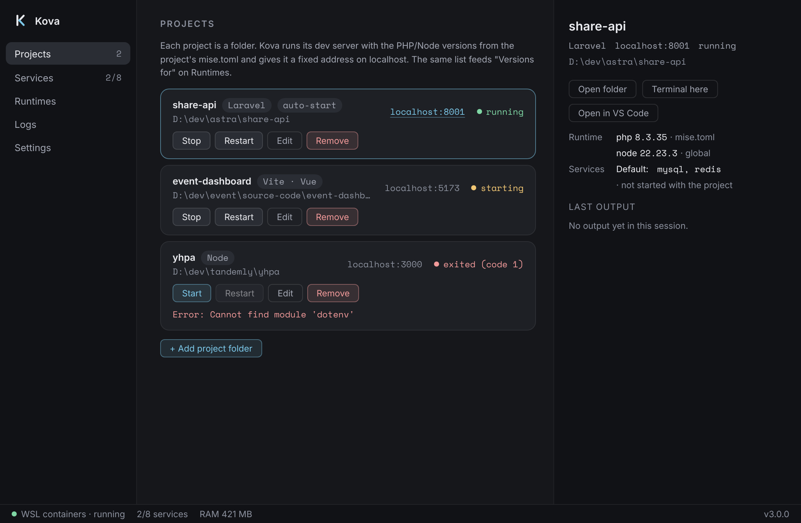
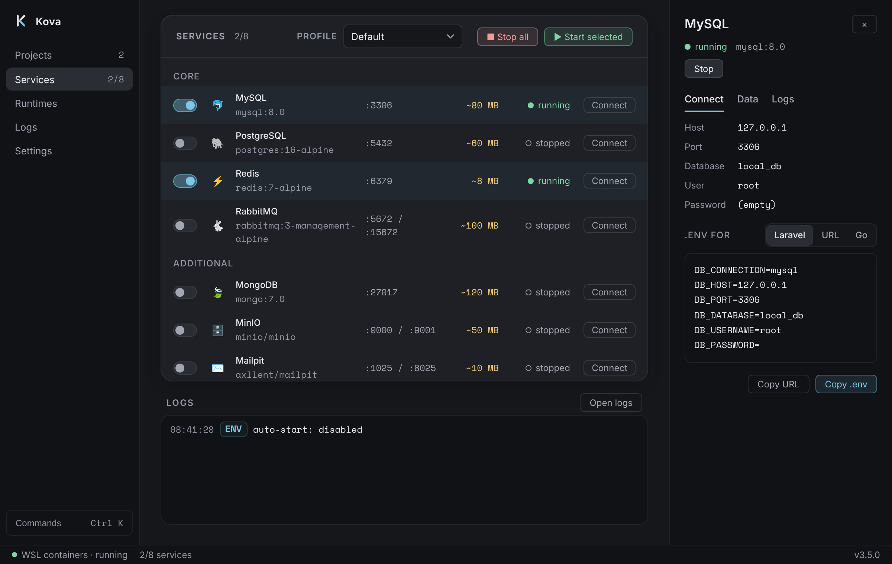

# Kova

> **One app. All your local dev environment.**

_Kova was called **Servel** up to v2.11. Your services, projects and settings carry over; the `servel` terminal command keeps working until v4.0._

Kova is a desktop app (Tauri 2 + Vue 3) that runs your local development environment from one window:

- **Services**: MySQL, PostgreSQL, Redis and friends in containers (WSL containers on Windows, or Docker).
- **Projects**: your Laravel, Vite, Nuxt, Node or Go apps, started for you on a fixed `localhost:<port>`.
- **Versions**: PHP and Node per project through [mise](https://mise.jdx.dev), plus PHP extensions per version.

No more juggling three terminals every morning.





---

## Features

**Projects**
- Add a project folder; Kova detects what it is (Laravel, Lumen, WordPress, Drupal, plain PHP, Vite with Vue/React/Svelte, Next, Nuxt, Angular, other Node apps, Go, Django, FastAPI, Flask, other Python apps) and suggests the dev-server command and a free port.
- Start, Stop, Restart and Open each project at `localhost:<port>`; its output goes to the Logs viewer.
- The dev server runs with the PHP/Node/Go versions from the project's `mise.toml`, plus any environment variables you set for that project.
- Optionally start a project when Kova opens, and link it to a service profile.
- **Details** per project: the PHP/Node versions mise resolves for that folder, its service profile, the last lines of output, and shortcuts to open the folder, a terminal there, or VS Code.
- Dev servers stop when Kova quits, and do not linger if Kova crashes.

**Services**
- MySQL, PostgreSQL, Redis, RabbitMQ, MongoDB, MinIO, Mailpit, Gotenberg. Toggle what you need, click Start.
- Windows: runs on WSL containers (`wslc`, built into WSL 3.0.1+). No Docker Desktop and no extra Linux distro needed. Docker stays available.
- A service shows "up" only once it accepts connections.
- **Connect** on each service opens a side panel with host, port and credentials, a preview of the `.env` lines, **Copy .env** (Laravel keys) and **Copy URL**.
- Service profiles and database restore from a `.sql` dump.

**Runtimes**
- With mise: see and switch PHP/Node versions per project, written to the `mise.toml` that actually applies. Go and Python versions can be installed and set in **Runtimes**.
- PHP extensions: turn bundled extensions on or off per PHP version. `php.ini` is backed up first and the change is undone if PHP no longer starts.
- Windows: one click fixes HTTPS from PHP (curl error 60).

**App**
- One window with five screens: **Projects**, **Services**, **Runtimes**, **Logs**, **Settings**. The status bar shows the container engine, running services, memory and version.
- **Command palette** (`Ctrl K`, `⌘K` on macOS): jump to a screen, start or stop a service, start, stop, restart or open a project, all from the keyboard.
- In-app updates from Settings → About.
- System tray, remembered selection, optional start when you sign in (in the tray), and a `kova` terminal command on Windows, macOS and Linux.

---

## Install

Download the installer for your OS from the [Releases page](https://github.com/devhardiyanto/servel/releases). File names below use `<version>` (for example `3.0.0`).

> Kova ships **unsigned** for Windows and macOS. Workarounds are documented below; see [Code signing](#code-signing) for the plan.

### Windows

1. Download `Kova_<version>_x64-setup.exe` from Releases.
2. Run the installer. Windows SmartScreen will warn: *"Windows protected your PC"*. Click **More info** → **Run anyway**.
3. When prompted about `.wslconfig`, choose:
   - **Yes (Overwrite)**: replace your existing `%USERPROFILE%\.wslconfig` with the Kova-recommended one (the old file is backed up to `.wslconfig.bak`).
   - **No (Append)**: append Kova's WSL2 settings to the bottom of your existing file.
   - **Cancel (Skip)**: leave `.wslconfig` untouched. Recommended if you use WSL containers and already tuned WSL yourself.
4. The installer also adds the `kova` terminal command to your user PATH (see [`kova` terminal command](#kova-terminal-command-windows)).
5. Launch Kova from the Start Menu. With WSL 3.0.1+, Kova uses the built-in WSL containers automatically.

**Upgrading from Servel 2.x:** use **Check for updates** in Servel, or run the Kova installer. The installer removes the old Servel app for you. Projects, profiles, settings and database volumes are kept: the data folder (`com.devhardiyanto.servel`) and the `servel_*` containers keep their names on purpose. In the terminal, `servel` still works until v4.0 and prints a one-line reminder to use `kova`.

**Updating:** from v2.1 on, open **Settings → About → Check for updates → Update now**. Kova stops running projects, installs the new version and reopens. Older versions update by installing the new release manually once.

If you changed `.wslconfig`, restart WSL once so it takes effect:

```powershell
wsl --shutdown
```

### macOS

1. Download `Kova_<version>_aarch64.dmg` (Apple Silicon) or `Kova_<version>_x64.dmg` (Intel) from Releases.
2. Open the DMG, drag **Kova.app** into your **Applications** folder.
3. On first launch macOS Gatekeeper blocks the app because it is unsigned. Open Terminal and run:
   ```bash
   xattr -d com.apple.quarantine /Applications/Kova.app
   ```
4. Launch Kova from Applications or Spotlight.
5. Optional: add the `kova` terminal command from **Settings → General → Terminal** (see [`kova` terminal command](#kova-terminal-command-macos-and-linux)).

### Linux

1. Download `Kova_<version>_amd64.AppImage` from Releases.
2. Make it executable and run:
   ```bash
   chmod +x Kova_<version>_amd64.AppImage
   ./Kova_<version>_amd64.AppImage
   ```
3. Optional: add the `kova` terminal command from **Settings → General → Terminal** (see [`kova` terminal command](#kova-terminal-command-macos-and-linux)).

---

## Prerequisites

Kova orchestrates external tools — it does not install them for you. Make sure these are available on your PATH before first run.

### Container engine

#### Windows — WSL containers (recommended)

Since v1.6 Kova can run services on **WSL containers** (`wslc.exe`), the container engine that ships with WSL 3.0.1 and newer. You do not need Docker Desktop or a dedicated Linux distro.

```powershell
wsl --update
wsl --version   # WSL version must be 3.0.1 or newer
```

Kova picks the engine automatically (**Settings → Container engine → Auto**). Since v2.0, WSL containers are the default on Windows; Kova stays on Docker only when `wslc` is missing or Docker still holds your `servel_*` containers. You can force either one in Settings.

Notes:

- WSL containers keep their **own images and volumes**, separate from Docker Desktop. Data in Docker volumes does not move over automatically; restore your database dumps after switching.
- Run Kova **without** "Run as administrator". WSL containers keep one session per elevation, so containers created from an elevated window are invisible to a normal one, and the reverse.
- Ports are published on `127.0.0.1` only.
- Containers named `servel_<service>` that already exist (for example, created by a script) are **adopted as-is**: Kova starts and stops them but does not recreate them.

#### `kova` terminal command (Windows)

The Windows installer adds a `kova` command to your user PATH (`%LOCALAPPDATA%\Kova\cli\bin`). It works in PowerShell, cmd, and Git Bash / zsh, and manages the same services as the app through WSL containers:

```bash
kova preflight                 # check wslc, WSL version, elevation, ports
kova up                        # start the services selected in the app (or all)
kova up mysql postgres         # only some
kova down                      # stop every servel_* container
kova status
kova logs mysql -f
kova shell postgres            # shell inside the container
kova restore mysql D:\backup\dump.sql   # or a folder of .sql files
kova use php@8.3               # via mise, in the current project folder (kova use php 8.3 also works)
kova use node@22 --global      # change the global version
kova service up mysql          # same as kova up mysql
kova projects                  # list projects from the app, with their localhost URLs
kova start share-api           # start a project's dev server (the Kova app must be open)
kova stop share-api
kova restart share-api
kova ps                        # state and URL of every project
```

The app and the CLI share state, so you can use them interchangeably. Open a **new** terminal after installing so it picks up the new PATH. If you previously aliased `kova` in your shell profile, remove that alias; otherwise it shadows the bundled command.

MSYS2 shells started with `MSYS2_PATH_TYPE=minimal` do not inherit the Windows PATH. Add this line to `~/.bashrc` / `~/.zshrc` instead:

```bash
export PATH="$PATH:$(cygpath "$LOCALAPPDATA")/Kova/cli/bin"
```

#### `kova` terminal command (macOS and Linux)

Open **Settings → General → Terminal** and click **Install**. Kova copies the command to `~/.local/bin/kova`; if that folder is not on your PATH, the same screen shows the line to add to your shell profile. After a Kova update, the button reads **Update** when the installed command is older.

```bash
kova up                        # start the services selected in the app
kova up mysql postgres         # only some
kova down                      # stop every service (or name some)
kova status
kova logs mysql -f
kova shell postgres
kova list                      # available services, images and ports
kova restore mysql dump.sql    # or a folder of .sql files
kova use php@8.3               # via mise, in the current project folder
kova start share-api           # start a project's dev server
kova stop share-api
kova restart share-api
kova ps                        # state and URL of every project
kova preflight                 # check Docker, mise and whether the app is open
```

How it differs from Windows: `up`, `down` and the project commands are carried out by the Kova app, so **the app must be open** (it may sit in the tray). `status`, `logs` and `shell` talk to Docker directly and work without the app. `kova list` shows the available services, and `kova restore mysql dump.sql` (or a folder of `.sql` files, loaded in name order) starts the service, waits until it accepts connections and loads the dump.

#### Docker

- **Windows / macOS:** [Docker Desktop](https://www.docker.com/products/docker-desktop/) — make sure it is running before starting any service from Kova.
- **Linux:** [Docker Engine](https://docs.docker.com/engine/install/) + the Compose v2 plugin. Add your user to the `docker` group so you do not need `sudo`.

### mise — PHP, Node, Go and Python versions

- Site: [mise.jdx.dev](https://mise.jdx.dev). On Windows, the first-run screen has an **Install mise** button (winget). Otherwise install it, then install the versions you need, for example `mise use -g php@8.3 node@22`.
- Kova manages PHP/Node versions only through mise (phpvm and fnm were removed in v3). Without mise, services and projects still run, but versions cannot be picked in the app.
- Versions are resolved per folder, so a `mise.toml` in a project (or one of its parent folders) decides which PHP/Node that project uses, both in Kova and in your terminal.

---

## First run

On first launch Kova checks what is installed: the container engine (WSL containers or Docker) and mise. Missing items show what to install. Click **Refresh checks** after installing, then **Continue to Kova**.

---

## Using Kova

Kova opens on **Projects**. The left rail switches between Projects, Services, Runtimes, Logs and Settings; the numbers next to them count running projects, running services and log errors.

Press `Ctrl K` (`⌘K` on macOS) anywhere to open the command palette: type part of a screen, project or service name, pick with the arrow keys and press Enter. The commands follow the current state, so a running project offers Open, Restart and Stop, and a stopped one offers Start.

### Services

1. Toggle the services you need. The selection is saved as a **profile**; create more profiles in **Settings → Services**.
2. Click **Start selected**. Each service shows "starting" until it accepts connections, then "up".
3. **Stop all** stops every service; the data stays in volumes.
4. **Connect** on a row opens a panel with the connection details and the `.env` lines to copy into your project.

Services listen on `127.0.0.1` with these defaults (for local development only):

| Service | Port | Login |
|---|---|---|
| MySQL | 3306 | `root`, no password; database `local_db` |
| PostgreSQL | 5432 | `postgres`, no password; database `local_db` |
| Redis | 6379 | none |
| RabbitMQ | 5672, UI 15672 | `guest` / `guest` |
| MongoDB | 27017 | none |
| MinIO | 9000, console 9001 | `admin` / `password` |
| Mailpit | SMTP 1025, UI 8025 | none |
| Gotenberg | 3030 | none |

To load data: **Settings → Services → Restore database** (pick a `.sql` dump for MySQL or PostgreSQL). Coming from Docker on Windows: dump the databases from Docker first (for example `docker exec servel_mysql mysqldump --all-databases > dump.sql`), then restore that file.

### Projects

1. Click **+ Add project folder** and pick the folder. Kova detects the type and opens the form with a suggested **Command** and **Port**.
2. Check the **Project settings** panel that opens on the right, then **Save & start**. Open it again later from the **⋯** menu on the project's card; the same menu has Open folder, Terminal here, Open in VS Code, Copy URL and Remove project.
3. When the status turns **running**, click `localhost:<port>` to open it.

| Field | What it does |
|---|---|
| **Command** | Any command, run in the project folder. `{port}` is replaced by the port, and the `PORT` variable is set to it. **Detect** fills it in again. Leave it empty to use the project only for versions and services. |
| **Port** | Fixed port on `localhost` (1024–65535). |
| **Services** | Service profile applied when you pick this project under **Versions for** on Runtimes. Tick **Start these services when the project starts** to have Start, Restart and start-on-launch also start that profile's services; running services are left alone and stopping the project stops none. |
| **Environment** | One `KEY=VALUE` per line, set for this project's dev server on top of mise's environment. Lines copied from a shell (`export KEY='value'`) work as-is. |
| **On launch** | Start this project when Kova opens. |

Examples of commands Kova suggests:

| Project | Command |
|---|---|
| Laravel | `php artisan serve --host=127.0.0.1 --port={port}` |
| Lumen / plain PHP | `php -S 127.0.0.1:{port} -t public` |
| WordPress | `php -S 127.0.0.1:{port}` |
| Vite (Vue/React) | `npm run dev -- --port {port} --strictPort` |
| Next | `npm run dev -- -p {port}` |
| Node backend | `npm run dev` (reads `PORT`) |
| Go | `go run .` or `air` (reads `PORT`) |

`npm` becomes `pnpm`, `yarn` or `bun` when that lockfile is present. **Restart** stops the project, waits for the port to be free and starts it again. Output shows under **Logs → Projects**. There, pick a project chip to see only its output, or **Errors & warnings** to hide everything else; each project keeps its own last 500 lines. **Filter lines** (or `Ctrl F`) narrows the list to lines containing the words you type. When a project exits or stops answering, **View log** on its card opens this view for that project.

Notes:

- Node backends and Go apps follow the port only if they read the `PORT` variable. Otherwise set the app's own port in **Port**; the status shows "port not answering" until something listens on it.
- Dependencies are not installed for you. Run `composer install` / `npm install` first; if a project exits, its card shows the last output line.
- On Windows, `php -S` and `artisan serve` handle one request at a time.

### PHP and Node versions

- **Runtimes → Versions for** picks the context: **Global** or one of your projects. The PHP and Node lists show the versions that apply there and where they come from (project `mise.toml` or global config).
- Switching a version in a project context writes to that project's `mise.toml`. If the version currently comes from your global config, Kova asks whether to pin it in the project or change it globally.
- A `mise.toml` that mise does not trust yet shows a **Trust** button.

### PHP extensions (Runtimes)

1. Pick the PHP version at the top of **PHP extensions**.
2. Turn extensions on or off with their switches. The change goes into that version's `php.ini` and applies to every project and terminal that uses the version. Restart running PHP projects to pick it up.
3. **Windows:** if **HTTPS certificates** says "Not set", click **Fix HTTPS certificates**. This sets `curl.cainfo` and `openssl.cafile`, which fixes curl error 60.

Before each change Kova backs up `php.ini` next to it (`php.ini.servel-<time>.bak`, last 5 kept). If PHP fails to start afterwards, the old `php.ini` is restored and the reason is shown.

Extensions that are not bundled (redis, xdebug, imagick, mongodb, ...) can be downloaded on Windows: type the name under **Install another extension** and click **Download & enable**. Kova picks the build from downloads.php.net that matches your PHP version, thread safety and architecture, puts the DLL in the `ext` folder (support libraries, as imagick has, go next to `php.exe`) and turns the extension on. If PHP rejects it, the DLL is removed and `php.ini` is put back. The download site publishes no checksums, so the only integrity check is HTTPS to php.net. On macOS and Linux, install extensions with `pecl install`; they then appear in the list.

### Tray menu

Right-click the tray icon for **Show Kova**, the **PHP** and **Node** version submenus, **Start all selected**, **Stop all** and **Quit Kova**. Closing the window keeps Kova in the tray (change it in **Settings → General**). Quitting stops running projects; services keep running until you stop them.

---

## FAQ & Troubleshooting

### "Port already in use" when starting a service

Another process is bound to the port Kova needs. Find it and stop it:

```powershell
# Windows
netstat -ano | findstr :3306

# macOS / Linux
lsof -i :3306
```

Stop the offending process and click Start again. For a project, pick another **Port** in **⋯ → Project settings**.

### "WSL containers is not responding" (Windows)

1. Make sure WSL is up to date: `wsl --update`, then `wsl --version` (3.0.1 or newer).
2. Restart the WSL service: `wsl --shutdown`, then click **Retry** in Kova.
3. `ERROR_SHARING_VIOLATION` on every command means the WSL container session is locked. `wsl --shutdown` clears it; if it persists, run `Restart-Service WslService -Force` from an elevated PowerShell.
4. `Too many volumes have been mounted` means the per-session mount limit was hit. `wsl --shutdown` resets it.

### Databases are empty after switching to WSL containers

Expected: WSL containers and Docker Desktop have separate storage. Dump the databases from Docker to a `.sql` file and use **Restore database**. You can also switch back to Docker in **Settings → Container engine**.

### "Docker not running" / containers fail to start

Start Docker Desktop (Windows/macOS) or the Docker daemon (Linux: `sudo systemctl start docker`) before clicking Start in Kova.

### `.wslconfig` settings not applied (Windows)

WSL only reads `.wslconfig` at startup. After install (or after editing the file), run:

```powershell
wsl --shutdown
```

Then start Kova (and Docker Desktop, if you use it) again.

### Windows SmartScreen blocks the installer

Kova releases are currently **unsigned**, so SmartScreen shows a warning. Click **More info** → **Run anyway**. The warning appears once, on install; in-app updates are not affected. See [Code signing](#code-signing).

### macOS says "Kova is damaged and can't be opened"

This is Gatekeeper's quarantine attribute on an unsigned app. Remove it:

```bash
xattr -d com.apple.quarantine /Applications/Kova.app
```

Releases are not notarized yet, so this is needed after each manual install.

### PHP: `cURL error 60: SSL certificate problem`

PHP on Windows has no certificate list. Open **Runtimes → PHP extensions** and click **Fix HTTPS certificates** for the PHP version you use. For a single project only, you can instead add `SSL_CERT_FILE=<path to ca-bundle.crt>` to its **Environment**.

### PHP extension change was undone

PHP printed a startup error with the new setting, so Kova restored `php.ini`; the message shows PHP's own error. Usually the DLL does not match the PHP version, thread safety (TS/NTS) or architecture. Download the matching build and try again.

### Project shows "port not answering"

The process is running but nothing listens on the project's port. The app probably uses its own port: check **Logs → Projects** for the address it prints, then set that port in **⋯ → Project settings** (or make the app read `PORT`). **View log** on the project's card opens that log directly.

### Old `.test` domains still resolve (upgraded from v2.1 or older)

The `.test` domains feature was removed in v2.2, and the cleanup buttons were removed in v3. Delete the lines between the Servel markers in your hosts file (as administrator) and remove the "Caddy Local Authority" certificate in `certmgr.msc` (Trusted Root Certification Authorities).

### Service stays stuck on "starting"

Check the Logs viewer for that service. Common causes: the image is still downloading on first run, a port conflict, or no disk space left. Kova marks a service "up" after 120 seconds even if its health check never passes, and writes a warning to the log.

---

## Contributing

Bug reports, feature requests, and pull requests are welcome.

- **Issues:** [github.com/devhardiyanto/servel/issues](https://github.com/devhardiyanto/servel/issues)
- **Discussions:** [github.com/devhardiyanto/servel/discussions](https://github.com/devhardiyanto/servel/discussions)

Please include your OS, Kova version, and relevant log output when filing a bug.

---

## Development

```bash
npm install
npm run tauri dev
```

Requirements: Node.js 20 LTS, Rust stable (via [rustup](https://rustup.rs/)), and platform-specific build tools (Visual Studio Build Tools "Desktop development with C++" on Windows; Xcode Command Line Tools on macOS; standard `build-essential` + `libwebkit2gtk-4.1-dev` on Linux).

---

## Privacy policy

Kova does not collect, transmit, or store any personal data. All configuration is saved locally on your machine only. There is no telemetry and no analytics. On launch Kova asks GitHub whether a newer release exists; no data about you or your machine is sent beyond that request. All other network calls are initiated by you (image pulls, version installs, downloading an update).

---

## Code signing

Kova releases are **not code-signed** on Windows or macOS, which is why SmartScreen and Gatekeeper warn on install (see the FAQ for the workarounds). Update packages are signed with Kova's own updater key and verified by the app before they are installed.

An application to the SignPath Foundation open-source program was declined in June 2026 because the project is still young; it will be submitted again once Kova has more public adoption.

---

## License

MIT. See [LICENSE](LICENSE) for details.
