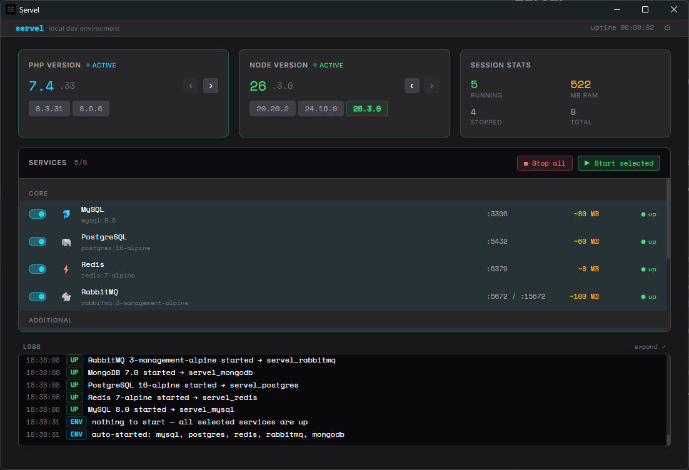
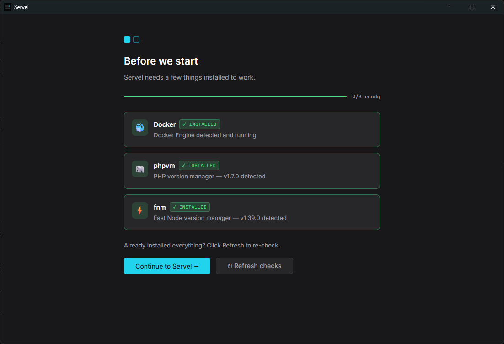
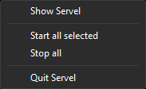
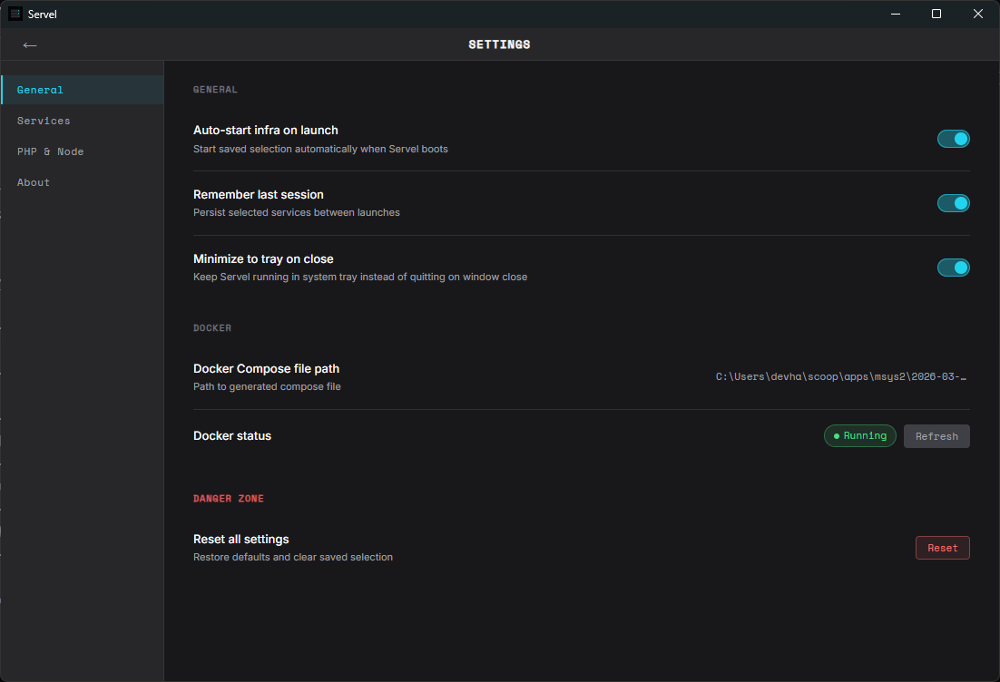
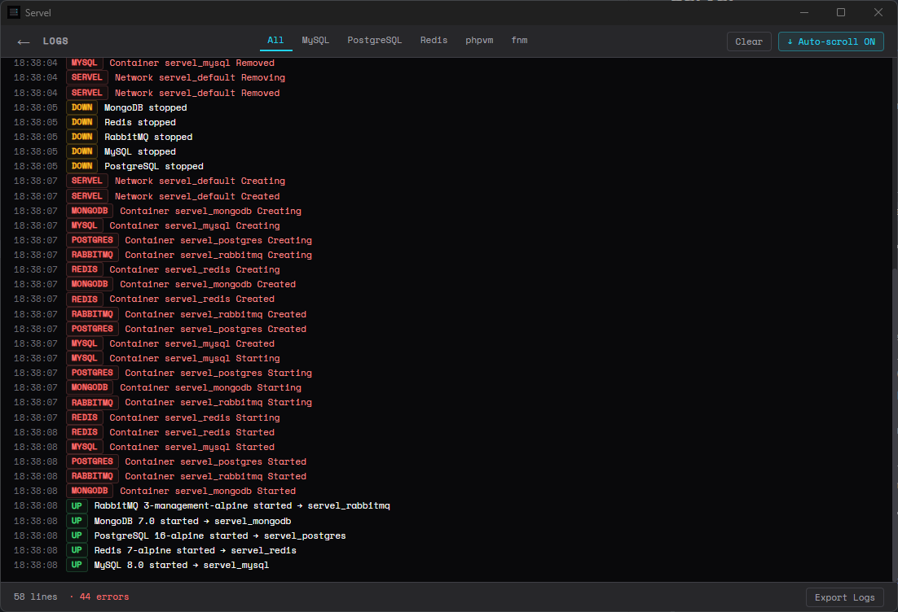

# Servel

> **One app. All your local dev environment.**

Servel is a desktop app (Tauri 2 + Vue 3) that orchestrates your local development environment from a single UI: switch PHP and Node versions, and start/stop Docker-based services — without juggling three terminals every morning.



---

## Features

- **Projects on localhost (new in v2.2)** — add a project folder and Servel detects what it is (Laravel, WordPress, Vite, Next, Node, Go, ...), runs its dev server with the versions from the project's `mise.toml`, and gives it a fixed `localhost:<port>` address. Start, stop, open and read its log from one place; optionally start it when Servel opens.
- **In-app updates (new in v2.1)** — Settings → About downloads, verifies and installs a new version, then restarts Servel.
- **Projects (v1.9)** — link a project folder to a service profile: selecting the project switches its PHP/Node versions (via mise) and its service selection together.
- **Database restore & Docker import (v1.8)** — restore a `.sql` dump into MySQL/PostgreSQL from Settings, or copy your databases from an old Docker container into WSL containers.
- **Readiness checks (v1.8)** — a service shows "up" only once it accepts connections, not just when its container starts.
- **mise integration (new in v1.7)** — when [mise](https://mise.jdx.dev) is installed, Servel shows and switches PHP/Node versions per project folder. It writes to the `mise.toml` that actually applies, and asks before pinning a version that currently comes from your global config.
- **PHP version switching** via [phpvm](https://github.com/devhardiyanto/phpvm) — list installed versions, switch active, install new.
- **Node version switching** via [fnm](https://github.com/Schniz/fnm) — same workflow as PHP.
- **WSL containers on Windows (new in v1.6)** — run every service on the container engine built into WSL (`wslc`). No Docker Desktop, no extra Linux distro. Docker stays available as an alternative.
- **Docker services orchestration** — MySQL, PostgreSQL, Redis, RabbitMQ, MongoDB, MinIO, Mailpit, Gotenberg. Toggle what you need, click Start.
- **Auto-detect `.phpvmrc` / `.nvmrc`** — point Servel at a project folder, it picks the right versions.
- **Persistent state + system tray** — Servel remembers your last selection; runs from the tray so it does not crowd your taskbar.
- **Dynamic `docker-compose.yml` generator** — only the services you toggled on are written to the compose file. Saves RAM, keeps the runtime clean.

---

## Install

Download the installer for your OS from the [Releases page](https://github.com/devhardiyanto/servel/releases). File names below use `<version>` (for example `1.7.0`).

> Servel ships **unsigned** for Windows and macOS. Workarounds are documented below; see the FAQ for the long-term plan.

### Windows

1. Download `Servel_<version>_x64-setup.exe` from Releases.
2. Run the installer. Windows SmartScreen will warn: *"Windows protected your PC"*. Click **More info** → **Run anyway**.
3. When prompted about `.wslconfig`, choose:
   - **Yes (Overwrite)**: replace your existing `%USERPROFILE%\.wslconfig` with the Servel-recommended one (the old file is backed up to `.wslconfig.bak`).
   - **No (Append)**: append Servel's WSL2 settings to the bottom of your existing file.
   - **Cancel (Skip)**: leave `.wslconfig` untouched. Recommended if you use WSL containers and already tuned WSL yourself.
4. The installer also adds the `servel` terminal command to your user PATH (see [`servel` terminal command](#servel-terminal-command-windows)).
5. Launch Servel from the Start Menu. With WSL 3.0.1+ and no Docker installed, Servel uses the built-in WSL containers automatically.

If you changed `.wslconfig`, restart WSL once so it takes effect:

```powershell
wsl --shutdown
```

### macOS

1. Download `Servel_<version>_aarch64.dmg` (Apple Silicon) or `Servel_<version>_x64.dmg` (Intel) from Releases.
2. Open the DMG, drag **Servel.app** into your **Applications** folder.
3. On first launch macOS Gatekeeper blocks the app because it is unsigned. Open Terminal and run:
   ```bash
   xattr -d com.apple.quarantine /Applications/Servel.app
   ```
4. Launch Servel from Applications or Spotlight.

### Linux

1. Download `Servel_<version>_amd64.AppImage` from Releases.
2. Make it executable and run:
   ```bash
   chmod +x Servel_<version>_amd64.AppImage
   ./Servel_<version>_amd64.AppImage
   ```

---

## Prerequisites

Servel orchestrates external tools — it does not install them for you. Make sure these are available on your PATH before first run.

### Container engine

#### Windows — WSL containers (recommended)

Since v1.6 Servel can run services on **WSL containers** (`wslc.exe`), the container engine that ships with WSL 3.0.1 and newer. You do not need Docker Desktop or a dedicated Linux distro.

```powershell
wsl --update
wsl --version   # WSL version must be 3.0.1 or newer
```

Servel picks the engine automatically (**Settings → Container engine → Auto**). Since v2.0, WSL containers are the default on Windows; Servel stays on Docker only when `wslc` is missing or Docker still holds your `servel_*` containers. You can force either one in Settings.

Notes:

- WSL containers keep their **own images and volumes**, separate from Docker Desktop. Data in Docker volumes does not move over automatically; restore your database dumps after switching.
- Run Servel **without** "Run as administrator". WSL containers keep one session per elevation, so containers created from an elevated window are invisible to a normal one, and the reverse.
- Ports are published on `127.0.0.1` only.
- Containers named `servel_<service>` that already exist (for example, created by a script) are **adopted as-is**: Servel starts and stops them but does not recreate them.

#### `servel` terminal command (Windows)

The Windows installer adds a `servel` command to your user PATH (`%LOCALAPPDATA%\Servel\cli\bin`). It works in PowerShell, cmd, and Git Bash / zsh, and manages the same services as the app through WSL containers:

```bash
servel preflight                 # check wslc, WSL version, elevation, ports
servel up                        # start the services selected in the app (or all)
servel up mysql postgres         # only some
servel down                      # stop every servel_* container
servel status
servel logs mysql -f
servel shell postgres            # shell inside the container
servel restore mysql D:\backup\dump.sql   # or a folder of .sql files
servel use php 8.3               # via mise, in the current project folder
servel use node 22 --global      # change the global version
servel projects                  # list the projects configured in the app
```

The app and the CLI share state, so you can use them interchangeably. Open a **new** terminal after installing so it picks up the new PATH. If you previously aliased `servel` in your shell profile, remove that alias; otherwise it shadows the bundled command.

MSYS2 shells started with `MSYS2_PATH_TYPE=minimal` do not inherit the Windows PATH. Add this line to `~/.bashrc` / `~/.zshrc` instead:

```bash
export PATH="$PATH:$(cygpath "$LOCALAPPDATA")/Servel/cli/bin"
```

#### Docker

- **Windows / macOS:** [Docker Desktop](https://www.docker.com/products/docker-desktop/) — make sure it is running before starting any service from Servel.
- **Linux:** [Docker Engine](https://docs.docker.com/engine/install/) + the Compose v2 plugin. Add your user to the `docker` group so you do not need `sudo`.

### phpvm — PHP version manager

- Repo: [github.com/devhardiyanto/phpvm](https://github.com/devhardiyanto/phpvm)
- Install via the instructions on the repo (PowerShell on Windows, shell installer on Linux/macOS).
- After install, add the `phpvm` hook to your shell profile so version switching takes effect in new terminals:
  ```bash
  phpvm hook
  ```

### fnm — Node version manager

- Repo: [github.com/Schniz/fnm](https://github.com/Schniz/fnm)
- Install via the official installer or your package manager (`winget install Schniz.fnm`, `brew install fnm`, `cargo install fnm`).
- Add the fnm shell hook to your profile as documented in the fnm README.

---

## First Run



On first launch Servel runs an **Onboarding** flow:

1. **Prerequisites check** — Servel detects Docker, phpvm, and fnm. Missing items get a red badge with a link to the install instructions.
2. **Pick your services** — toggle the services you usually use. You can change this later.
3. **Pick versions** — choose your active PHP and Node versions from the lists detected by phpvm and fnm.
4. **Done** — you land on the Dashboard. Click **Start** to bring up your selected services.

---

## Tray Menu



Servel runs from the system tray. Right-click the tray icon for:

- **Show Servel** — open the main window.
- **Start all selected** — bring up every service currently toggled on.
- **Stop all** — bring down every running service.
- **Quit Servel** — exit the app (services keep running unless you stopped them first).

---

## Screens

- 
- 

---

## FAQ & Troubleshooting

### "Port already in use" when starting a service

Another process is bound to the port Servel needs. Find it and stop it:

```powershell
# Windows
netstat -ano | findstr :3306

# macOS / Linux
lsof -i :3306
```

Stop the offending process, or change the service port mapping in Servel Settings.

### "WSL containers is not responding" (Windows)

1. Make sure WSL is up to date: `wsl --update`, then `wsl --version` (3.0.1 or newer).
2. Restart the WSL service: `wsl --shutdown`, then click **Retry** in Servel.
3. `ERROR_SHARING_VIOLATION` on every command means the WSL container session is locked. `wsl --shutdown` clears it; if it persists, run `Restart-Service WslService -Force` from an elevated PowerShell.
4. `Too many volumes have been mounted` means the per-session mount limit was hit. `wsl --shutdown` resets it.

### Databases are empty after switching to WSL containers

Expected: WSL containers and Docker Desktop have separate storage. Restore your dumps into the new containers (for example with `mysql < dump.sql` via `wslc exec -i servel_mysql ...`), or switch back to Docker in **Settings → Container engine**.

### "Docker not running" / containers fail to start

Start Docker Desktop (Windows/macOS) or the Docker daemon (Linux: `sudo systemctl start docker`) before clicking Start in Servel.

### `phpvm` hook not installed — PHP version does not change

Make sure your shell profile (`~/.bashrc`, `~/.zshrc`, or PowerShell `$PROFILE`) sources the phpvm hook. Run `phpvm hook` and follow the printed instructions, then restart your shell.

### `.wslconfig` settings not applied (Windows)

WSL only reads `.wslconfig` at startup. After install (or after editing the file), run:

```powershell
wsl --shutdown
```

Then start Docker Desktop again.

### Windows SmartScreen blocks the installer

Servel v1.0 is **unsigned** to keep the project free of certificate costs during beta. SmartScreen will show a warning — click **More info** → **Run anyway**. Code signing is on the roadmap for v1.1 if adoption justifies the cost.

### macOS says "Servel is damaged and can't be opened"

This is Gatekeeper's quarantine attribute on an unsigned app. Remove it:

```bash
xattr -d com.apple.quarantine /Applications/Servel.app
```

Apple notarization is on the roadmap for v1.1.

### Service stays stuck on "starting"

Check the Logs viewer for that service. Common causes: image still pulling on first run, port conflict, or Docker out of disk space (`docker system prune` to reclaim).

---

## Contributing

Bug reports, feature requests, and pull requests are welcome.

- **Issues:** [github.com/devhardiyanto/servel/issues](https://github.com/devhardiyanto/servel/issues)
- **Discussions:** [github.com/devhardiyanto/servel/discussions](https://github.com/devhardiyanto/servel/discussions)

Please include your OS, Servel version, and relevant log output when filing a bug.

---

## Development

```bash
npm install
npm run tauri dev
```

Requirements: Node.js 20 LTS, Rust stable (via [rustup](https://rustup.rs/)), and platform-specific build tools (Visual Studio Build Tools "Desktop development with C++" on Windows; Xcode Command Line Tools on macOS; standard `build-essential` + `libwebkit2gtk-4.1-dev` on Linux).

---

## Privacy policy

Servel does not collect, transmit, or store any personal data. All configuration is saved locally on your machine only. There is no telemetry and no analytics. On launch Servel asks GitHub whether a newer release exists; no data about you or your machine is sent beyond that request. All other network calls are initiated by you (image pulls, version installs, downloading an update).

---

## Code signing policy

Free code signing on Windows provided by [SignPath.io](https://about.signpath.io), certificate by [SignPath Foundation](https://signpath.org).

- Committers and reviewers: [@devhardiyanto](https://github.com/devhardiyanto)
- Approvers: [@devhardiyanto](https://github.com/devhardiyanto)

This program will not transfer any information to other networked systems unless specifically requested by the user or the person installing or operating it.

---

## License

MIT. See [LICENSE](LICENSE) for details.
